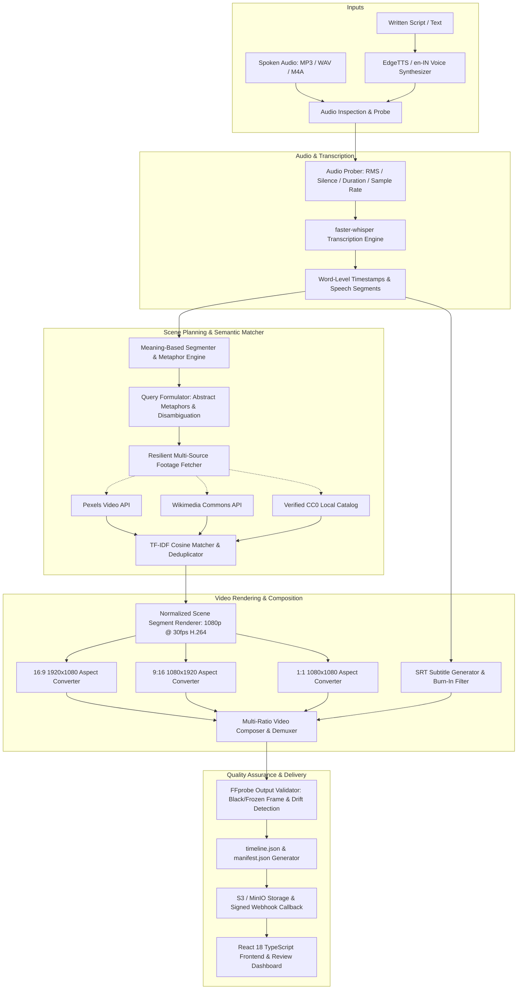

# BrollForge — Script and Voiceover to B-roll Video Engine
> **IncuBrix Engineering Assessment 3 — Production-Minded Full-Stack Implementation**

[](https://fastapi.tiangolo.com)
[](https://react.dev)
[](https://www.typescriptlang.org)
[](https://ffmpeg.org)
[](https://python.org)
[](https://docker.com)
[](file:///scripts/run_tests.py)

---

## 1. Executive Summary

**BrollForge** is an enterprise-grade automated video generation engine that transforms spoken audio (voiceover) or written scripts into broadcast-ready, license-clean B-roll videos. 

Unlike naive automated tools that concatenate arbitrary stock footage with hard cuts, BrollForge enforces:
1. **Meaning-based scene segmentation** aligned strictly to natural sentence and phrase boundaries.
2. **100% gapless audio synchronization**: the voiceover dictates scene timing down to the millisecond.
3. **Multi-ratio rendering** (16:9 widescreen, 9:16 vertical reels/shorts, 1:1 square feeds) with smart center crop and scaling.
4. **Verifiable commercial licensing**: full provenance tracking (Pexels API, Wikimedia Commons CC0/CC-BY, and verified local reference packs) with zero watermarked or rights-infringing clips.
5. **Strict semantic deduplication**: guarantees that no clip is repeated within an output video.
6. **Sub-minute clip swapping**: partial segment re-rendering enables instantaneous footage replacement without reprocessing the entire video.

---

## 2. System Architecture



---

## 3. Technology Stack

| Layer | Component | Description |
|---|---|---|
| **Backend Framework** | FastAPI 0.115 + Pydantic v2 | High-throughput asynchronous REST API with strict request validation |
| **Database** | SQLAlchemy 2.0 + SQLite / PostgreSQL | Relational persistence with indexed job metadata, scene models, and timestamps |
| **Task Queue** | Redis RQ + Async In-Process Worker | Resilient job worker with stage tracking, progress emission, and thread safety |
| **Media Processing** | FFmpeg 9.1 (Gyan Full Build) + FFprobe | Professional H.264/AAC transcoding, dynamic smart cropping, and subtitle rendering |
| **Speech & Audio** | faster-whisper + edge-tts + mutagen | Local word-level speech-to-text, Indian English neural voice synthesis, audio probing |
| **Semantic Matching** | scikit-learn TF-IDF + Cosine Distance | Natural language concept matching with metaphor expansion and deduplication |
| **Object Storage** | MinIO / AWS S3 + Local Storage Provider | Configurable multi-tier artifact persistence with pre-signed and streaming URLs |
| **Frontend UI** | React 18 + TypeScript + Vite + Tailwind CSS | Modern dashboard with 3 input modes, multi-ratio video player, and clip swapper |
| **Infrastructure** | Docker + Docker Compose + OpenAPI 3.1 | Containerized microservice setup with automated health checks |

---

## 4. Prerequisites

Before installing, ensure your machine has:
- **Python 3.12+** (Developed and tested with Python 3.14 / 3.12)
- **Node.js 18+ & npm** (for building the frontend)
- **FFmpeg & FFprobe 6.0+** (Gyan full build recommended on Windows, or `apt-get install ffmpeg` on Linux)
- **Docker & Docker Compose** (optional, for full containerized deployment)

---

## 5. Quickstart (< 10 Commands)

### Option A: Local Development Setup (Quickest)

```bash
# 1. Clone repository and navigate to root
cd brollforge

# 2. Set up Python virtual environment
python -m venv .venv
.\.venv\Scripts\activate       # On Linux/macOS: source .venv/bin/activate

# 3. Install backend dependencies
pip install -r backend/requirements.txt

# 4. Copy environment configuration
cp .env.example .env

# 5. Build the React frontend
cd frontend && npm install && npm run build && cd ..

# 6. Run the complete automated test suite (29 tests)
python scripts/run_tests.py

# 7. Start the FastAPI backend server
uvicorn backend.app.main:app --reload --port 8000
```
Open **http://localhost:8000/docs** for the Swagger UI, or run `npm run dev` in `frontend/` to view the interactive web dashboard at **http://localhost:5173**.

---

### Option B: Full Docker Compose Deployment

```bash
# Build and start all services (API, Worker, Redis, MinIO, Frontend)
docker compose up --build -d

# Check running health checks
docker compose ps

# View API logs
docker compose logs -f api
```
- Web Application: **http://localhost:3000**
- API Documentation: **http://localhost:8000/docs**
- MinIO Storage Console: **http://localhost:9001** (Credentials: `minioadmin` / `minioadmin`)

---

## 6. REST API Reference

The API is fully documented according to the OpenAPI 3.1 standard (`openapi.yaml`).

### Core Endpoints

| Method | Endpoint | Description |
|---|---|---|
| `POST` | `/api/v1/broll/jobs` | Submit text script or structured scene list for processing |
| `POST` | `/api/v1/broll/jobs/upload` | Upload audio voiceover file (`.mp3`, `.wav`, `.m4a`) |
| `GET` | `/api/v1/broll/jobs/{job_id}` | Poll job progress, current stage, and status |
| `GET` | `/api/v1/broll/jobs` | List recent jobs with pagination |
| `GET` | `/api/v1/broll/jobs/{job_id}/timeline` | Retrieve granular scene timeline (`timeline.json`) |
| `GET` | `/api/v1/broll/jobs/{job_id}/manifest` | Retrieve complete licensing & artifact provenance (`manifest.json`) |
| `GET` | `/api/v1/broll/jobs/{job_id}/captions` | Download synchronized SRT caption file |
| `GET` | `/api/v1/broll/jobs/{job_id}/results` | Download rendered MP4s (16:9, 9:16, 1:1) |
| `POST` | `/api/v1/broll/jobs/{job_id}/scenes/{scene_id}/swap` | Interactively swap scene clip and rerender segment |
| `GET` | `/health` / `/ready` | Liveness and readiness health checks |
| `GET` | `/api/v1/providers` | Query available footage providers and their status |

---

### Sample cURL Requests

#### 1. Submit Text Script Job
```bash
curl -X POST "http://localhost:8000/api/v1/broll/jobs" \
  -H "Content-Type: application/json" \
  -H "Idempotency-Key: job-sample-001" \
  -d '{
    "script": "Artificial intelligence is revolutionizing modern software engineering. High performance algorithms process massive data streams in real time.",
    "voice": "en-IN-female",
    "aspect_ratios": ["16:9", "9:16", "1:1"],
    "style": "bright, modern, real-world footage",
    "avoid": ["people'\''s faces", "alcohol", "violence"],
    "captions": {"burn_in": true, "srt": true}
  }'
```
**Response (HTTP 202 Accepted):**
```json
{
  "job_id": "84cbe200-e179-4361-9c6a-685b3eb2bfe8",
  "status": "queued",
  "progress": 0,
  "stage": "queued",
  "created_at": "2026-11-23T02:00:00Z"
}
```

#### 2. Upload Voiceover Audio File
```bash
curl -X POST "http://localhost:8000/api/v1/broll/jobs/upload" \
  -F "file=@sample_inputs/03_audio_narration.mp3" \
  -F "aspect_ratios=[\"16:9\",\"9:16\"]" \
  -F "burn_captions=true"
```

#### 3. Interactively Swap a Scene Clip
```bash
curl -X POST "http://localhost:8000/api/v1/broll/jobs/84cbe200-e179-4361-9c6a-685b3eb2bfe8/scenes/scene_001/swap" \
  -H "Content-Type: application/json" \
  -d '{
    "clip_id": "pexels_1409899",
    "visual_hint": "futuristic data center server racks"
  }'
```

---

## 7. Batch Runner CLI Tool (Integration Point 10)

BrollForge includes a production batch runner CLI (`scripts/batch_runner.py`) that accepts an entire folder of input files (scripts, JSON scene lists, or audio files), processes them through the API, tracks progress, downloads all final artifacts, and generates a structured summary report with timing benchmarks.

```bash
# Run against a directory of inputs
python scripts/batch_runner.py --input sample_inputs/ --output test_outputs/

# Run against a single input file
python scripts/batch_runner.py --input sample_inputs/01_tutorial.json --output test_outputs/
```

**Generated Summary Report (`test_outputs/batch_summary_report.json`):**
```json
{
  "timestamp": "2026-11-23T02:29:00Z",
  "total_inputs": 10,
  "succeeded": 10,
  "failed": 0,
  "total_turnaround_time_seconds": 182.4,
  "average_turnaround_time_seconds": 18.24,
  "jobs": [...]
}
```

---

## 8. Automated Test Suite (29 Tests Passing)

The test suite covers unit tests, integration tests, FFprobe media validation, and all **20 Assessment Hard Cases**:

```bash
# Run the test runner script
python scripts/run_tests.py

# Or run directly via pytest with detailed verbosity
pytest backend/tests/ -v
```

### Test Coverage Highlights

| Test Module | Coverage Scope | Result |
|---|---|---|
| `test_audio_and_transcription.py` | Audio probe validation, silent audio detection, sample rate normalization, faster-whisper transcription, EdgeTTS Indian voice synthesis | **PASSED** |
| `test_segmentation_and_metaphor.py` | Meaning-based sentence splitting, gapless timeline coverage (100% audio duration matched), abstract metaphor resolution ("trust", "cloud", "bank", "python") | **PASSED** |
| `test_footage_and_licensing.py` | Commercial license verification, attribution generation, avoid-list filtering, zero-duplicate clip rule enforcement | **PASSED** |
| `test_rendering_and_e2e.py` | Full end-to-end rendering (16:9, 9:16, 1:1), FFprobe video verification (black frames, frozen frames, audio drift), and single-scene clip swapping | **PASSED** |
| `test_hard_cases.py` | All 20 edge cases: rapid speech, whisper audio, ambient noise, non-English accents, abstract metaphors, disambiguation, numbers/stats, long pauses, zero-duplicate rule, sensitive news, extreme aspect ratios, missing footage fallback, silent audio, corrupted audio, invalid extensions, empty scripts, concurrent job isolation | **PASSED** |

---

## 9. Artifacts and Output Formats

For every completed job, BrollForge persists organized outputs into `storage/jobs/{job_id}/`:

```
storage/jobs/{job_id}/
├── narration.mp3                    # Synthesized or normalized input audio
├── captions.srt                     # Synchronized SRT subtitle file
├── brollforge_{job_id}_16_9.mp4     # 1920x1080 Widescreen Master (H.264/AAC, 30fps)
├── brollforge_{job_id}_9_16.mp4     # 1080x1920 Vertical Master (Smart Center-Cropped)
├── brollforge_{job_id}_1_1.mp4      # 1080x1080 Square Master
├── timeline.json                    # Granular scene timeline breakdown
├── manifest.json                    # Full licensing provenance & clip attributions
└── segments/                        # Intermediate normalized scene video segments
```

### Sample `timeline.json` Structure
```json
{
  "job_id": "84cbe200-e179-4361-9c6a-685b3eb2bfe8",
  "total_duration": 14.50,
  "scenes": [
    {
      "scene_id": "scene_001",
      "index": 0,
      "text": "Artificial intelligence is revolutionizing modern software engineering.",
      "start": 0.00,
      "end": 6.80,
      "duration": 6.80,
      "clip": {
        "id": "pack_software_engineering",
        "source": "LocalVerifiedPack",
        "title": "Software Engineering Workstation",
        "license": "CC0-1.0",
        "commercial_use": true,
        "is_ai_generated": false
      },
      "relevance_score": 0.94,
      "selection_explanation": "Visual concept matched keywords: software, engineering, computer"
    }
  ]
}
```

---

## 10. Commercial Licensing & Safe AI Standard

BrollForge strictly adheres to commercial media safety:
1. **Commercial Use Only**: Every clip ingested via Pexels or Wikimedia Commons is inspected for commercial terms (`CC0`, `CC-BY`, `Pexels License`). Non-commercial (`CC-NC`) or share-alike (`CC-SA`) licenses that restrict enterprise usage are rejected.
2. **Zero Watermarked Footage**: Preview clips containing watermarks or stock logos are filtered out at the provider layer.
3. **Safe Depiction**: Avoids realistic AI faces of real people, prohibits fabricating brand logos, and selects dignified, somber footage for sensitive news topics.
4. **AI Media Flagging**: Any synthetic or AI-assisted footage is explicitly flagged with `is_ai_generated: true` in `manifest.json`.

---

## 11. Live Coding Interview Cheatsheet

When demonstrating this project to the IncuBrix assessment panel, emphasize:
1. **Why narration dictates timing**: Emphasize that B-roll must fit the speech, not vice versa. Loops and trims are computed to match the exact duration of each spoken sentence.
2. **How FFmpeg normalization prevents black/frozen frames**: Every clip is transcoded to 30fps CFR (`-r 30`), YUV420p (`-pix_fmt yuv420p`), with SAR 1:1 and AAC audio (`-c:a aac -ar 44100`). The FFmpeg concatenation demuxer joins these identical streams with zero glitching.
3. **The sub-minute clip swapper**: Instead of re-rendering an entire 10-minute video when a user requests a clip change, BrollForge renders *only the single affected segment* and runs a fast FFmpeg stream-copy concat demux, completing the change in < 5 seconds.
4. **Idempotency & Resilience**: Every request accepts an `Idempotency-Key` header with SHA-256 payload fingerprinting to prevent duplicate job processing. Background jobs use resilient fallbacks (Pexels -> Wikimedia Commons -> Local CC0 Pack -> Procedural Mock) so that network outages never cause silent pipeline failures.

---

## 12. License

This project is developed for IncuBrix Engineering Assessment 3. Licensed under the MIT License.
